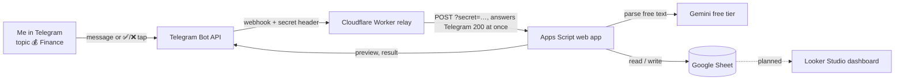

# Finance Tracker Bot

A personal finance tracker you talk to in Telegram. Type `kopi 25rb pake gopay`, confirm with ✅, and it lands in a
Google Sheet. Ask `pengeluaran minggu ini?` or `berapa tabunganku sekarang?` and it answers from the Sheet.
It runs entirely on free tiers: no server, no credit card, $0 per month.

- **Chat:** Telegram group "Radikal AI Assistant", topic 💰 Finance (other topics are reserved for future features)
- **Brain:** Gemini (free tier) turns free text into structured transactions; all numbers come from code, not the model
- **Backend:** Google Apps Script web app
- **Storage:** Google Sheet (four tabs), with a live balance per account
- **Relay:** a Cloudflare Worker in front of Apps Script, so replies are instant

## How it works



1. **Access check** (`Code.gs`): only my user id, only allowed chats, and in the group only the Finance topic.
   Everything else is ignored silently.
2. **Routing**: a "ya"/"batal" answers a pending confirmation; `/commands` are handled in code (no Gemini call);
   anything else goes to Gemini, which returns an intent (`log`, `correct`, `delete`, `query`, `other`),
   the transactions, and a one-line joke (`quip`).
3. **Validation** (`Sheet.gs`): amounts, types, categories and accounts are checked against the Sheet.
4. **Confirmation** (`Confirm.gs`): every change shows a preview with ✅ Simpan / ❌ Batal. Nothing is written
   until I confirm. Questions and lists answer directly.
5. **Write and reply**: the row is written, the preview turns into the result, plus budget warnings if any.

Why the relay: Apps Script answers every webhook POST with a 302 redirect. Telegram treats that as a failed
delivery, keeps resending the first message, and newer messages queue behind it forever. The Worker answers
Telegram with 200 itself and forwards the update to Apps Script.

## Using the bot

| Type this | What happens |
|---|---|
| `makan siang 35rb gofood` | Expense, category Makan, merchant Gofood |
| `gaji 15jt masuk bca` | Income to BCA |
| `tap lrt 17k pake gopay` | Expense paid from GoPay |
| `top up gopay pake bni 200k` | Transfer BNI → GoPay (not spending) |
| `nabung 2jt dari bca ke bibit` | Transfer between accounts (here into an investment account, which leaves Tabungan) |
| `kopi 25rb, parkir 5rb` | Two transactions from one message |
| `tambah akun Bibit 5jt investasi` / `saldo awal BCA 10jt` / `Bibit itu investasi` | Add an account, or set its opening balance or kind (same as `/akun`) |
| `budget makan 1,5jt` / `hapus budget makan` / `status budget?` | Set, remove, show monthly budgets (same as `/budget`) |
| `kategori apa aja?` / `tambah kategori Hobi` | List / add categories (same as `/kategori`) |
| `hapus transaksi a1b2c3d4` | Delete one transaction by id (same as `/hapus <id>`) |
| `bisa apa aja?` | Help (same as `/help`) |
| `ubah yang tadi jadi 40rb` / `salah, pakai bca` | Correct the last transaction |
| `hapus yang tadi` | Delete everything the last message logged |
| `pengeluaran minggu ini?` / `savings rate bulan ini?` | Summaries (today, week, month, or `sampai sekarang`) |
| `saldo gopay?` / `berapa tabunganku sekarang?` / `investasiku?` | Current balances |
| `5 transaksi terakhir` | Latest entries |

Amounts understand `35rb`, `35k`, `15jt`, `1,5jt`, `2.500.000`. Dates understand `kemarin`, `senin lalu`.

Every command below except `/whereami` also works as a normal chat message; the slash versions are optional
shortcuts that skip the Gemini call.

| Command | Purpose |
|---|---|
| `/help` | Everything above, in the chat |
| `/saldo` | All balances, grouped by account kind |
| `/akun BNI 1,5jt` | Add an account or set its opening balance |
| `/akun Bibit 5jt investasi` / `/akun Bibit investasi` | Add with a kind / change the kind |
| `/budget makan 1,5jt` / `/budget makan 0` / `/budget` | Set, remove, show monthly budgets |
| `/kategori` / `/kategori expense Hobi` | List / add categories |
| `/terakhir 10` | Latest entries with their ids |
| `/hapus a1b2c3d4` | Delete one transaction by id |
| `/whereami` | Show chat, topic and user ids (setup) |

Budget warnings appear on every expense in a category once it reaches 80% (⚠️) or 100% (🚨) of this month's limit.

Scheduled messages (in the Finance topic, 09:00 WIB, each within the hour):

| When | Message |
|---|---|
| Every Monday | Last week (Mon–Sun): spending, top categories, income, saving, this month's budget status, and a spending alert: ±20% versus the average of up to 4 earlier weeks, with the category that grew most |
| 1st of the month | Last month: the same totals, savings rate, budget results, an alert versus up to 3 earlier months, and a values-only backup of every tab into Google Drive > `finance-tracker backups` (old backups are kept) |

Earlier periods from before tracking started are skipped, so they do not count as zero spending.

## Dashboard (in the Sheet)

The first tab, `dashboard`, is generated by the bot on a fixed ~1100 px grid (made for a laptop screen):

- **Header** with the month and the last refresh time.
- **Five KPI cards**: spending, income, sisa, savings rate and Tabungan, each with the change versus the same days
  of last month (▲/▼, colored by whether the change is good) and a small monthly trend.
- **Tren bulanan** (income, spending, sisa) and **spending per category** this month, as charts.
- **Spending per week** as a chart, next to **every account's balance** with in-cell bars and a total.
- **Budget bars** for this month, turning ⚠️ at 80% and 🚨 at 100%.

Charts start at the first transaction (up to 12 months / 12 weeks) and show amounts in ribu or juta. The look is
soft: pastel header and cards, and the softest series colors that pass the dataviz palette check (income blue,
spending peach, sisa mint). Their contrast on white is low, so every number is also printed in the cards and tables,
and the chart data stays visible in the `dashboard_data` tab.

The numbers come from the same functions the bot answers with, so the tab and the chat always agree. The tab is
rebuilt after every confirmed change and every day at 06:00 WIB; run `refreshDashboard()` after editing the Sheet by
hand. Don't edit the tab itself: it is overwritten.

## Data model (Google Sheet)

| Tab | Columns | Notes |
|---|---|---|
| `transactions` | `id, date, amount, type, category, account, merchant, note, raw_message, created_at, to_account` | One row per transaction. `type` is expense, income, saving or transfer. `to_account` is only for transfers. |
| `categories` | `type, category` | The only categories Gemini may use. Edit rows or use `/kategori`. |
| `accounts` | `account, opening_balance, current_balance, kind` | `current_balance` is a live SUMIFS formula. `kind` is bank, ewallet, cash, tabungan, investasi or lainnya, guessed from the name. |
| `budgets` | `category, monthly_limit` | Expense categories only. |

Definitions used everywhere (bot answers and formulas agree):

- **Account balance** = opening balance + income − expense − saving − transfers out + transfers in.
- **Tabungan** = the money I hold now: the balance of every account except investasi and e-wallets (banks, cash,
  anything else), opening balances included. There is no savings quota to set aside; it matches the banking apps.
  Investasi is reported separately ("investasiku?").
- **Sisa** = income − expense in a period: what was kept, or overspent. A month with spending but no income yet
  (for example because the salary arrived before the bot was set up) has a negative sisa.
  Questions like "ditabung bulan ini?" or "sisa kas?" answer with it.
- **Savings rate** = (income − expense) / income. Transfers and `saving` rows are never spending or income.
- A plain `nabung 2jt` (no destination) is type `saving`: it leaves the tracked accounts. Name the account to keep it visible.

## Repository layout

| Path | What it is |
|---|---|
| `apps-script/Code.gs` | Entry points (`doPost`), access rules, message routing |
| `apps-script/Confirm.gs` | Pending action, ✅/❌ buttons, typed yes/no, dispatch to commit functions |
| `apps-script/Sheet.gs` | Sheet access, validation, prepare/commit for log, correct, delete; balances; summaries |
| `apps-script/Accounts.gs` | Account kinds and name-based guessing |
| `apps-script/Budget.gs` | Budgets and warnings |
| `apps-script/Commands.gs` | Slash commands and `/help` text |
| `apps-script/Gemini.gs` / `Prompt.gs` | Gemini call (structured JSON, retries) and the parsing prompt |
| `apps-script/Reports.gs` | Scheduled weekly/monthly recaps, spending alert, monthly backup |
| `apps-script/Dashboard.gs` | Generated `dashboard` tab with tables and charts |
| `apps-script/Persona.gs` | Emoji and robot lines |
| `apps-script/Telegram.gs` | Bot API helpers; replies stay in the topic |
| `apps-script/Setup.gs` | `setup()`, webhook helpers, `checkConfig()` |
| `apps-script/Tests.gs` | `runExamples()`: 26 messages with expected parses |
| `relay/worker.js` | Cloudflare Worker relay |
| `CLAUDE.md` | Project notes: decisions and status |

## Configuration

Apps Script > Project Settings > Script Properties. Secrets live only here and in Cloudflare, never in git.

| Property | Required | Value |
|---|---|---|
| `TELEGRAM_BOT_TOKEN` | yes | From @BotFather |
| `GEMINI_API_KEY` | yes | From aistudio.google.com |
| `GEMINI_MODEL` | no | Default `gemini-3.5-flash-lite` |
| `SHEET_ID` | yes | The id in the Sheet URL |
| `ALLOWED_USER_ID` | yes | My Telegram user id; nobody else is answered |
| `ALLOWED_CHAT_ID` | yes | Comma-separated chat ids (group, and private chat if wanted) |
| `FINANCE_TOPIC_ID` | no | Only this group topic is answered |
| `WEBHOOK_SECRET` | yes | Letters, digits, `_` or `-` only (Telegram rule), e.g. `openssl rand -hex 16` |
| `WEBAPP_URL` | yes | The web app `/exec` URL |
| `RELAY_URL` | yes | The Worker URL |
| `LAST_UPDATE_ID`, `PENDING` | internal | Written by the bot; do not edit |

Cloudflare Worker secrets: `TELEGRAM_SECRET` (= `WEBHOOK_SECRET`) and `APPS_SCRIPT_URL`
(= `WEBAPP_URL` + `?secret=` + `WEBHOOK_SECRET`).

## Development

Code lives in this repo and is uploaded with Google's clasp, installed in the project (not globally).
The repo is the source of truth: do not edit code in the browser editor, the next push overwrites it.

```bash
npm install            # once
npm run login          # once; pick the personal Google account. Token goes to .clasp-auth/ (gitignored)
npm run check          # syntax check of all .gs files together (also catches duplicate globals)
npm run deploy         # check + push + new version of the existing web app deployment (same /exec URL)
npm run push           # check + push only; the live bot keeps running the deployed version
```

One-time requirement: the Apps Script API must be on at https://script.google.com/home/usersettings.

Functions to run from the Apps Script editor:

| Function | When |
|---|---|
| `setup()` | After schema changes. Safe to re-run: adds missing tabs, headers, formulas, kinds; never overwrites rows. |
| `runExamples()` | After prompt changes. ~2.5 min, uses ~26 Gemini requests, writes nothing. |
| `checkConfig()` | When the bot is silent. Prints every setting check without showing secrets. |
| `setWebhook()` | Point Telegram at the relay (`RELAY_URL`) and drop queued updates. |
| `installSchedules()` | Once, to start the scheduled recaps, backup and daily dashboard refresh. Safe to re-run (replaces all triggers). Asks for Drive access (backup). |
| `refreshDashboard()` | Rebuild the `dashboard` tab now (e.g. after editing the Sheet by hand). |
| `weeklySummary()` / `monthlySummary()` | Run by hand to see a recap now (the monthly one also makes a backup). |

## Setup from scratch

1. **Telegram:** create a bot with @BotFather. `/setprivacy` → Disable (so it sees plain messages in groups).
   Create a group with Topics, add a "💰 Finance" topic, add the bot and make it admin.
2. **Google:** create a blank Sheet, then Extensions > Apps Script. Copy the Script ID into `.clasp.json`.
   Get a Gemini API key at aistudio.google.com.
3. **Code:** `npm install`, `npm run login`, `npm run push`.
4. **Properties:** set the required Script Properties above.
5. **Sheet:** run `setup()`, then `runExamples()` (expect 26/26).
6. **Web app:** Deploy > New deployment > Web app, execute as Me, access Anyone. Put the `/exec` URL in
   `WEBAPP_URL` and its deployment id in the `deploy` script in `package.json`.
7. **Relay:** on a free Cloudflare account, create a Worker, paste `relay/worker.js`, add the two Worker secrets,
   and put the Worker URL in `RELAY_URL`.
8. **Connect:** run `setWebhook()`, then `checkConfig()`. Every check should be true and the last error "none".
9. **Ids:** send `/whereami` in the Finance topic and set `ALLOWED_USER_ID`, `ALLOWED_CHAT_ID` (group id first:
   scheduled reports go to the first id), `FINANCE_TOPIC_ID`.
10. **Schedules:** run `installSchedules()`.
## Troubleshooting

| Symptom | Check |
|---|---|
| Bot is silent | `checkConfig()`. Then Executions: `doPost` rows show why, e.g. `Ignored: sender is not ALLOWED_USER_ID`. |
| Silent only in the group | BotFather privacy must be Disabled, and the bot re-added to the group after changing it. Check `FINANCE_TOPIC_ID`. |
| `Wrong response from the webhook: 302` | Telegram points at Apps Script directly. Set `RELAY_URL` and run `setWebhook()`. |
| Worker logs show 403 | `TELEGRAM_SECRET` differs from `WEBHOOK_SECRET`. |
| `Ignored: missing or wrong secret` | The `?secret=` in `APPS_SCRIPT_URL` differs from `WEBHOOK_SECRET`. |
| Gemini 404 | Model retired for new accounts. Change `GEMINI_MODEL`. |
| Gemini 429 | Free quota hit. See https://ai.dev/rate-limit; lite models have far more quota. |
| Code change has no effect | Webhook mode runs the deployed version: use `npm run deploy`, not `push`. |

## Limits and privacy

- **Gemini free tier** (on my project, October 2026): `gemini-3.5-flash-lite` 15 requests/min, 500/day.
  Free-tier prompts may be used by Google to improve its products, so never type account numbers or similar.
- **Apps Script** (free account): a 6-minute limit per run; a message takes a few seconds.
- **Cloudflare Workers** free plan: far above personal use.
- Access is owner-only: other group members, other topics and other chats are ignored, including button taps.
